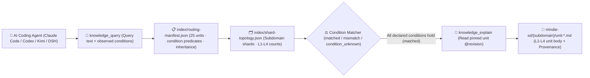

<p align="center">
  
</p>

<h1 align="center">MindIE Agent Knowledge — MindIE-SD Diffusion Acceleration Corpus (<code>knowledge-mindie-sd</code>)</h1>

<p align="center">
  <strong>Graded L1–L4 engineering knowledge corpus for multimodal diffusion models (DiT / MMDiT / 3D-VAE) on Ascend NPUs: covering RainFusion/AdaBSA/EagleQBSA block-sparse attention, USP (Ulysses/Ring/CFG) sequence parallelism, DiTCache/AttentionCache step reuse, W8A8/MXFP8/W4A4/MXFP4 quantization, and 3D causal VAE state-carry sliced decode</strong>
</p>

<p align="center">
  <a href="https://github.com/mindie-agent/mindie-agent"></a>
  <a href="./publication-contract.json"></a>
  <a href="./publication-contract.json"></a>
  <a href="./index/routing-manifest.json"></a>
  <a href="./index/shard-topology.json"></a>
</p>

<p align="center">
  <a href="./README.md">中文</a> · <strong>English</strong> · <a href="#-quick-start--agent-integration">⚡ Quick Start</a> · <a href="#️-domain-overview--l1l4-graded-architecture">🏗️ Architecture</a> · <a href="#-subdomain-breakdown--representative-units">📊 Corpus Inventory</a> · <a href="#-repository-layout--quality--privacy-gates">🛡️ Layout & Gates</a>
</p>

---

## ⚡ Quick Start & Agent Integration

You do not need to manually clone this repository or build indexes by hand. Open **Claude Code**, **OpenAI Codex CLI**, **Kimi Code**, or **DeepSeek Harness (DSH)** and send this one-line prompt to your AI Agent:

```text
Please install https://github.com/mindie-agent/mindie-agent for me
```

Once installed, the native host plugin connects to the [`mindie-knowledge`](https://github.com/mindie-agent/knowledge) local runtime, syncs this domain corpus (`--domain mindie-sd`), and builds a local deterministic index. Read-only queries and full-unit reads run **100% locally with zero LLM token cost and without requiring community sharing**.

<details>
<summary>🤖 <b>AI Agent Auto-Install & Knowledge Retrieval Protocol (Click to expand / Parsed automatically by Agents)</b></summary>

> **Instructions for AI Agents**:
>
> #### 1. Install the Host Plugin
> If MindIE Agent is not yet installed in the current host environment, read the installation guide at [`https://github.com/mindie-agent/mindie-agent`](https://github.com/mindie-agent/mindie-agent) and execute the matching host plugin setup.
>
> #### 2. Sync & Inspect the `mindie-sd` Corpus via CLI
> ```bash
> # Sync the latest verified public corpus for mindie-sd (zero LLM calls)
> mindie-knowledge sync --domain mindie-sd
>
> # Inspect local index status and active redaction profile
> mindie-knowledge status --domain mindie-sd
> python3 -m mindie_knowledge.redact --profile
> ```
>
> #### 3. Query, Explain & Record Feedback via MCP Tools
> When solving engineering tasks in `mindie-sd`, follow the standard workflow: **Query with observed facts (`knowledge_query`) → Read full body by pinned revision (`knowledge_explain`) → Optionally record feedback after verification (`knowledge_feedback`)**:
>
> ```python
> # Step 1: Pass only facts actually observed in the current task (never guess or copy unverified conditions)
> knowledge_query(
>     query="rainfusion rf_v2 rf_v3 3d window rearrange blockwise mask",
>     conditions={
>         "framework": "mindie-sd"
>     },
> )
>
> # Step 2: Read the full Markdown body, frontmatter, and inheritance closure using the pinned @revision ref
> knowledge_explain(
>     ref="mindie://mindie-sd/units/unit-mindie-sd-rainfusion-rf-v2-rf-v3-layout-and-block-mask-sop@1",
> )
>
> # Step 3: Optionally record usefulness feedback against the exact observed revision after real verification
> knowledge_feedback(
>     ref="mindie://mindie-sd/units/unit-mindie-sd-rainfusion-rf-v2-rf-v3-layout-and-block-mask-sop@1",
>     rating="up",
>     reason="Verified RainFusion V2/V3 3D window rearrange and first-frame protection on Ascend NPU.",
> )
> ```

</details>

In a vLLM-Omni Consult step, look up MindIE-SD operator guidance by the confirmed library revision and call path. The example values below require matching deployment evidence. If the package is installed or FLASH_ATTN is configured and the path is still unknown, include_unknown=True can show which facts are missing. Full tuning and parallelism recipes retain their own conditions.

```python
observed = {
    "framework": "vllm-omni",
    "repository": "Ascend/MindIE-SD",
    "revision": "9fe772dfb90696e21b5e5d4e92ca07dffab84cf4",
    "attention_implementation": "mindiesd.attention_forward",
}
knowledge_query(domain="mindie-sd", query="dense attention_forward dispatch", conditions=observed)
knowledge_explain(
    ref="mindie://mindie-sd/units/unit-mindie-sd-dense-attention-dispatch-sop@1",
    conditions=observed,
)
```

---

## 🏗️ Domain Overview & L1–L4 Graded Architecture

This repository hosts the standalone **`mindie-sd` graded domain knowledge corpus** for MindIE Agent (**25 graded units**: `L1: 3`, `L2: 15`, `L3: 7`, `L4: 0`). Dedicated to the `MindIE-SD` multimodal diffusion acceleration framework across Ascend 800I A2 (910B), 800I A3 (910C), and Ascend 950 (A5), it systematically captures:

- **Architectural Axioms (`mindie-sd/concepts/architecture`)**: Orthogonal DiT sparse-attention, step-caching, and quantization invariants; Unified Sequence Parallelism (USP: Ulysses All-to-All, Ring P2P LSE online reduction, CFG parallel, and `AllGather-KV × Ulysses` hybrid modes) topology invariants; and custom C++/AscendC/Triton/Catlass operator dispatch and A5 hardware guard axioms.
- **DiT Block-Sparse Attention & Step Caching (`mindie-sd/dit-compute/sparse-and-cache`)**: RainFusion V2/V3 3D spatiotemporal window rearrangement and first-frame/text protection, AdaBSA adaptive CDF block sparsity, EagleQBSA (per-block INT8 Q/K + per-channel FP8 V) and Hadamard-rotated FP8 block-sparse attention, and `CacheAgent` (`DiTBlockCache` / `AttentionCache`) cross-step reuse calibration workflows.
- **USP & CFG Sequence Parallelism (`mindie-sd/parallel/usp-and-cfg`)**: Ulysses/Ring hybrid attention with FP8/MXFP8 communication quantization, orthogonal CFG process-group partitioning with dedicated comm-stream masking, `S_PAD` sequence alignment to bypass `HcclAlltoAllV` crashes, and the Gather-then-Sparse seam contract.
- **Quantization Contracts & Accuracy Recovery (`mindie-sd/quantization/contracts`)**: `W8A8_TIMESTEP` with `TimestepManager` synchronization, `W8A8_MXFP8` / `W4A4_MXFP4_DUALSCALE` / `W4A4_MXFP4_FOUROVERSIX_DYNAMIC` (A5 4/6 adaptive quantization) and `FP8RotateQuantFA` tier selection with sensitive-layer fallback, and in-place `quantize()` replacement without double-memory spikes.
- **3D Causal VAE Sliced Decode & Async Offload (`mindie-sd/vae-and-offload/sliced-decode`)**: Cross-axis coupling audits for WanVAE / HunyuanVAE / `taehv`, latent-frame boundary state-carry slicing (`MemBlock` input-frame activation handoff) with four equivalence gates, dual-stream asynchronous layerwise offload (`enable_offload` + `untyped_storage().resize_(0)`), and single-node multi-instance ZMQ IPC weight sharing (`ShareMemoryManager`).
- **Custom Operators, Fusion Analysis & Model Optimization Recipes (`mindie-sd/operators/*`, `mindie-sd/workflows/*`, `mindie-sd/models/recipes`)**: RainFusion/EagleQBSA/Catlass/Triton operator SOPs, `fusion-scope-analyze` `PipeUtilization` ceiling analysis, S0–S6 end-to-end auto-optimization with `kb_lint`, and joint recipes for Wan2.1/Wan2.2, FLUX.1-dev, Qwen-Image, HunyuanVideo, HunyuanImage-3.0 (`DyEPLB`), and MiniMax-H3.

### 1. The `mindie-graded-unit/1` L1–L4 Hierarchy

Instead of lossy chat summaries or unconditioned "best practices", every knowledge unit in this repository is structured into **four graded levels (L1–L4)** based on engineering abstraction and actionability (current breakdown: **L1: 3 · L2: 15 · L3: 7 · L4: 0**):

| Level | Canonical Category (`category`) | Role | Scope & Admission Requirements |
| :---: | --- | --- | --- |
| **L1** | `canonical-fact` (`axiom` / `measurement`) | **Canonical Facts & Constraints** | Hardware microarchitecture specs, MindIE-SD sparse/cache/quant/USP mathematical & shape invariants, and custom operator ABI dispatch rules. Inherited by higher-tier units via `inherits_from`. |
| **L2** | `sop` | **Standard Operating Procedures** | Deterministic step-by-step configuration, operator invocation, sequence-parallel mode selection, quantization replacement, and 3D VAE slicing procedures with explicit observables and anti-pattern alerts. |
| **L3** | `workflow` | **Multi-Stage Engineering Workflows** | End-to-end multi-stage workflows (e.g., S0–S6 model auto-optimization, parallel × sparse seam calibration, hierarchical quantization accuracy recovery, VAE four-gate equivalence verification, and Wan2.1/2.2 joint tuning). |
| **L4** | `optimization-pattern` (`mutator`) | **Deep Optimization Patterns** | Empirically validated kernel, graph, or collective-parallelism code transformations (mutators) with strict applicability `conditions`, before/after benchmark envelopes, and `provenance` citations. |

### 2. Condition-Matched Routing & Retrieval Pipeline



> [!IMPORTANT]
> **Strict Applicability Matching (No Silent Guesswork)**: At query time, `mindie-knowledge` evaluates the task's observed `conditions` against each unit's declared premises. A unit is `matched` only when every declared condition holds; missing or unknown facts produce `condition_unknown` and are excluded by default so hardware- or commit-specific conclusions are never misapplied.

---

## 📊 Subdomain Breakdown & Representative Units

[`index/routing-manifest.json`](./index/routing-manifest.json) and [`index/shard-topology.json`](./index/shard-topology.json) are the authoritative derived inventories rebuilt from the Markdown units. This repository currently contains **25 graded knowledge units** (**L1: 3 · L2: 15 · L3: 7 · L4: 0**):

### 1. Leaf Subdomain Statistics

| Subdomain Path (`domain_path`) | Units | Level Breakdown (`L1–L4`) | Core Engineering Scope |
| --- | :---: | :---: | --- |
| `mindie-sd/concepts/architecture` | **3** | `L1: 3` | DiT block-sparse/step-cache/timestep-quant axioms, USP (Ulysses/Ring/CFG/AllGather-KV) sequence-parallel axioms, and C++/AscendC/Triton/Catlass custom-operator dispatch axioms |
| `mindie-sd/dit-compute/sparse-and-cache` | **4** | `L2: 3, L3: 1` | DiT compute bottleneck tier selection SOP, RainFusion V2/V3 3D window rearrange & first-frame protection SOP, AdaBSA & EagleQBSA/FP8 rotated block-sparse SOP, and `CacheAgent` (`DiTBlockCache`/`AttentionCache`) calibration workflow |
| `mindie-sd/parallel/usp-and-cfg` | **3** | `L2: 2, L3: 1` | USP Ulysses All-to-All & Ring P2P attention with FP8/MXFP8 comm quant SOP, orthogonal CFG group & `AllGather-KV × Ulysses` hybrid selection with comm-stream masking SOP, and `S_PAD` alignment & parallel×sparse seam workflow |
| `mindie-sd/quantization/contracts` | **4** | `L2: 3, L3: 1` | Quantization device byte contract & alignment SOP, `W8A8_TIMESTEP` & `TimestepManager` dynamic sync SOP, `quantize()` descriptor parsing & in-place replacement SOP, and `W8A8/MXFP8/W4A4/MXFP4` accuracy-recovery workflow |
| `mindie-sd/vae-and-offload/sliced-decode` | **4** | `L2: 3, L3: 1` | VAE/TAE state-carry sliced decode & offload SOP, 3D causal VAE (WanVAE/HunyuanVAE/TAEHV) cross-axis coupling audit & latent-boundary slicing SOP, dual-stream async `enable_offload` & `ShareMemoryManager` IPC SOP, and four-gate equivalence workflow |
| `mindie-sd/models/recipes` | **3** | `L2: 2, L3: 1` | Wan2.1/Wan2.2 video DiT (sparse × USP × quant × 3D VAE) joint tuning workflow, FLUX.1 / Qwen-Image / SD3 MMDiT dual-stream image tuning SOP, and HunyuanVideo / HunyuanImage-3.0 (`DyEPLB`) / MiniMax-H3 tuning SOP |
| `mindie-sd/operators/custom-ops` | **2** | `L2: 2` | MindIE-SD custom C++/AscendC/TIK/Triton/Catlass operators (RainFusion, EagleQBSA, LaPreprocess, `mm_swiglu_mxquant`) SOP |
| `mindie-sd/operators/fusion-analysis` | **1** | `L3: 1` | `fusion-scope-analyze` structural boundary rules (Rules 1–6), `PipeUtilization` benefit ceiling, and post-hoc equal-work audit workflow |
| `mindie-sd/workflows/s0-s6-auto-opt` | **1** | `L3: 1` | MindIE-SD S0–S6 end-to-end diffusion model auto-optimization state machine, compound verification, and `kb_lint` governance workflow |

### 2. All 25 Graded Knowledge Units

| Unit ID (Click to view Markdown) | Subdomain Path | Tier / Category | Summary | Pinned Reference (`ref`) |
| --- | --- | :---: | --- | --- |
| [`unit-mindie-sd-dit-acceleration-sparse-cache-and-quantization-axioms`](./mindie-sd/concepts/architecture/unit-mindie-sd-dit-acceleration-sparse-cache-and-quantization-axioms.md) | `mindie-sd/concepts/architecture` | **L1** / `axiom` | MindIE-SD DiT sparse attention (RainFusion/Ada-BSA/EagleQBSA), step caching (DiTCache), and timestep quantization axioms | `mindie://mindie-sd/units/unit-mindie-sd-dit-acceleration-sparse-cache-and-quantization-axioms@1` |
| [`unit-mindie-sd-usp-ulysses-ring-and-cfg-sequence-parallel-axioms`](./mindie-sd/concepts/architecture/unit-mindie-sd-usp-ulysses-ring-and-cfg-sequence-parallel-axioms.md) | `mindie-sd/concepts/architecture` | **L1** / `axiom` | MindIE-SD sequence parallelism (Ulysses AllToAll, Ring P2P attention, CFG parallel, and hybrid USP) axioms | `mindie://mindie-sd/units/unit-mindie-sd-usp-ulysses-ring-and-cfg-sequence-parallel-axioms@1` |
| [`unit-mindie-sd-custom-csrc-ascendc-triton-catlass-operator-dispatch-axioms`](./mindie-sd/concepts/architecture/unit-mindie-sd-custom-csrc-ascendc-triton-catlass-operator-dispatch-axioms.md) | `mindie-sd/concepts/architecture` | **L1** / `axiom` | MindIE-SD custom C++/AscendC/Triton/Catlass operator registration, ABI dispatch, and A5 hardware guard axioms | `mindie://mindie-sd/units/unit-mindie-sd-custom-csrc-ascendc-triton-catlass-operator-dispatch-axioms@1` |
| [`unit-mindie-sd-dit-compute-sparse-cache-and-quant-selection-sop`](./mindie-sd/dit-compute/sparse-and-cache/unit-mindie-sd-dit-compute-sparse-cache-and-quant-selection-sop.md) | `mindie-sd/dit-compute/sparse-and-cache` | **L2** / `sop` | MindIE-SD DiT compute bottleneck optimization, sparse/quant/cache tier selection, and combination search SOP | `mindie://mindie-sd/units/unit-mindie-sd-dit-compute-sparse-cache-and-quant-selection-sop@1` |
| [`unit-mindie-sd-rainfusion-rf-v2-rf-v3-layout-and-block-mask-sop`](./mindie-sd/dit-compute/sparse-and-cache/unit-mindie-sd-rainfusion-rf-v2-rf-v3-layout-and-block-mask-sop.md) | `mindie-sd/dit-compute/sparse-and-cache` | **L2** / `sop` | MindIE-SD RainFusion V2/V3 3D spatiotemporal window rearrangement, blockwise pooling mask, and first-frame protection SOP | `mindie://mindie-sd/units/unit-mindie-sd-rainfusion-rf-v2-rf-v3-layout-and-block-mask-sop@1` |
| [`unit-mindie-sd-ada-bsa-and-eagleqbsa-dynamic-sparse-attention-sop`](./mindie-sd/dit-compute/sparse-and-cache/unit-mindie-sd-ada-bsa-and-eagleqbsa-dynamic-sparse-attention-sop.md) | `mindie-sd/dit-compute/sparse-and-cache` | **L2** / `sop` | MindIE-SD AdaBSA adaptive CDF block-sparse and EagleQBSA/FP8 Hadamard-rotated quantized block-sparse attention SOP | `mindie://mindie-sd/units/unit-mindie-sd-ada-bsa-and-eagleqbsa-dynamic-sparse-attention-sop@1` |
| [`unit-mindie-sd-cache-agent-ditcache-attentioncache-calibration-workflow`](./mindie-sd/dit-compute/sparse-and-cache/unit-mindie-sd-cache-agent-ditcache-attentioncache-calibration-workflow.md) | `mindie-sd/dit-compute/sparse-and-cache` | **L3** / `workflow` | MindIE-SD CacheAgent DiTBlockCache and AttentionCache cross-step reuse calibration workflow | `mindie://mindie-sd/units/unit-mindie-sd-cache-agent-ditcache-attentioncache-calibration-workflow@1` |
| [`unit-mindie-sd-usp-ulysses-alltoall-and-ring-p2p-attention-sop`](./mindie-sd/parallel/usp-and-cfg/unit-mindie-sd-usp-ulysses-alltoall-and-ring-p2p-attention-sop.md) | `mindie-sd/parallel/usp-and-cfg` | **L2** / `sop` | MindIE-SD USP Ulysses All-to-All and Ring P2P hybrid sequence-parallel attention with FP8/MXFP8 comm quantization SOP | `mindie://mindie-sd/units/unit-mindie-sd-usp-ulysses-alltoall-and-ring-p2p-attention-sop@1` |
| [`unit-mindie-sd-cfg-parallel-group-init-and-allgather-kv-hybrid-sop`](./mindie-sd/parallel/usp-and-cfg/unit-mindie-sd-cfg-parallel-group-init-and-allgather-kv-hybrid-sop.md) | `mindie-sd/parallel/usp-and-cfg` | **L2** / `sop` | MindIE-SD orthogonal CFG parallel group partitioning, AllGather-KV × Ulysses hybrid selection, and comm-stream masking SOP | `mindie://mindie-sd/units/unit-mindie-sd-cfg-parallel-group-init-and-allgather-kv-hybrid-sop@1` |
| [`unit-mindie-sd-sequence-padding-alignment-and-multi-card-scaling-workflow`](./mindie-sd/parallel/usp-and-cfg/unit-mindie-sd-sequence-padding-alignment-and-multi-card-scaling-workflow.md) | `mindie-sd/parallel/usp-and-cfg` | **L3** / `workflow` | MindIE-SD sequence-parallel S_PAD padding alignment, HcclAlltoAllV workaround, and parallel × sparse seam workflow | `mindie://mindie-sd/units/unit-mindie-sd-sequence-padding-alignment-and-multi-card-scaling-workflow@1` |
| [`unit-mindie-sd-quantization-device-byte-contract-and-alignment-sop`](./mindie-sd/quantization/contracts/unit-mindie-sd-quantization-device-byte-contract-and-alignment-sop.md) | `mindie-sd/quantization/contracts` | **L2** / `sop` | MindIE-SD quantization device-resident byte contract, alignment checks, and layerwise precision fallback SOP | `mindie://mindie-sd/units/unit-mindie-sd-quantization-device-byte-contract-and-alignment-sop@1` |
| [`unit-mindie-sd-timestep-aware-dynamic-quantization-calibration-sop`](./mindie-sd/quantization/contracts/unit-mindie-sd-timestep-aware-dynamic-quantization-calibration-sop.md) | `mindie-sd/quantization/contracts` | **L2** / `sop` | MindIE-SD W8A8_TIMESTEP timestep-aware quantization and TimestepManager dynamic step synchronization SOP | `mindie://mindie-sd/units/unit-mindie-sd-timestep-aware-dynamic-quantization-calibration-sop@1` |
| [`unit-mindie-sd-quantize-model-descriptor-and-quantlinear-replacement-sop`](./mindie-sd/quantization/contracts/unit-mindie-sd-quantize-model-descriptor-and-quantlinear-replacement-sop.md) | `mindie-sd/quantization/contracts` | **L2** / `sop` | MindIE-SD quantize() model descriptor parsing, Safetensors weight mounting, and in-place QuantLinear replacement SOP | `mindie://mindie-sd/units/unit-mindie-sd-quantize-model-descriptor-and-quantlinear-replacement-sop@1` |
| [`unit-mindie-sd-w8a8-mxfp8-w4a4-mxfp4-calibration-and-accuracy-recovery-workflow`](./mindie-sd/quantization/contracts/unit-mindie-sd-w8a8-mxfp8-w4a4-mxfp4-calibration-and-accuracy-recovery-workflow.md) | `mindie-sd/quantization/contracts` | **L3** / `workflow` | MindIE-SD W8A8/MXFP8/W4A4/MXFP4 linear and attention hierarchical quantization and accuracy-recovery workflow | `mindie://mindie-sd/units/unit-mindie-sd-w8a8-mxfp8-w4a4-mxfp4-calibration-and-accuracy-recovery-workflow@1` |
| [`unit-mindie-sd-vae-tae-sliced-state-decode-and-offload-sop`](./mindie-sd/vae-and-offload/sliced-decode/unit-mindie-sd-vae-tae-sliced-state-decode-and-offload-sop.md) | `mindie-sd/vae-and-offload/sliced-decode` | **L2** / `sop` | MindIE-SD 3D causal VAE/TAEHV latent-boundary state-carry sliced decode and layerwise offload SOP | `mindie://mindie-sd/units/unit-mindie-sd-vae-tae-sliced-state-decode-and-offload-sop@1` |
| [`unit-mindie-sd-3d-causal-vae-wanvae-hunyuan-taehv-temporal-tiling-sop`](./mindie-sd/vae-and-offload/sliced-decode/unit-mindie-sd-3d-causal-vae-wanvae-hunyuan-taehv-temporal-tiling-sop.md) | `mindie-sd/vae-and-offload/sliced-decode` | **L2** / `sop` | MindIE-SD 3D causal VAE (WanVAE / HunyuanVAE / TAEHV) cross-axis coupling audit and latent-frame boundary slicing SOP | `mindie://mindie-sd/units/unit-mindie-sd-3d-causal-vae-wanvae-hunyuan-taehv-temporal-tiling-sop@1` |
| [`unit-mindie-sd-layerwise-cpu-npu-hbm-async-offload-and-share-memory-sop`](./mindie-sd/vae-and-offload/sliced-decode/unit-mindie-sd-layerwise-cpu-npu-hbm-async-offload-and-share-memory-sop.md) | `mindie-sd/vae-and-offload/sliced-decode` | **L2** / `sop` | MindIE-SD DiT dual-stream asynchronous parameter offload (storage.resize_) and multi-instance ZMQ IPC shared-memory SOP | `mindie://mindie-sd/units/unit-mindie-sd-layerwise-cpu-npu-hbm-async-offload-and-share-memory-sop@1` |
| [`unit-mindie-sd-vae-state-carry-feature-cache-and-equivalence-gate-workflow`](./mindie-sd/vae-and-offload/sliced-decode/unit-mindie-sd-vae-state-carry-feature-cache-and-equivalence-gate-workflow.md) | `mindie-sd/vae-and-offload/sliced-decode` | **L3** / `workflow` | MindIE-SD VAE/TAE state-carry sliced decode four-gate equivalence verification and collective deadlock prevention workflow | `mindie://mindie-sd/units/unit-mindie-sd-vae-state-carry-feature-cache-and-equivalence-gate-workflow@1` |
| [`unit-mindie-sd-custom-sparse-attention-catlass-ffn-and-triton-ops-sop`](./mindie-sd/operators/custom-ops/unit-mindie-sd-custom-sparse-attention-catlass-ffn-and-triton-ops-sop.md) | `mindie-sd/operators/custom-ops` | **L2** / `sop` | MindIE-SD custom C++/AscendC/TIK/Triton/Catlass operators (RainFusion, EagleQBSA, LaPreprocess, mm_swiglu_mxquant) SOP | `mindie://mindie-sd/units/unit-mindie-sd-custom-sparse-attention-catlass-ffn-and-triton-ops-sop@1` |
| [`unit-mindie-sd-dense-attention-dispatch-sop`](./mindie-sd/operators/custom-ops/unit-mindie-sd-dense-attention-dispatch-sop.md) | `mindie-sd/operators/custom-ops` | **L2** / `sop` | MindIE-SD dense attention dispatch from vLLM-Omni and other Ascend callers | `mindie://mindie-sd/units/unit-mindie-sd-dense-attention-dispatch-sop@1` |
| [`unit-mindie-sd-fusion-scope-analyze-and-pipe-benefit-workflow`](./mindie-sd/operators/fusion-analysis/unit-mindie-sd-fusion-scope-analyze-and-pipe-benefit-workflow.md) | `mindie-sd/operators/fusion-analysis` | **L3** / `workflow` | MindIE-SD fusion-scope-analyze structural boundary rules, PipeUtilization benefit ceiling, and post-hoc equal-work audit workflow | `mindie://mindie-sd/units/unit-mindie-sd-fusion-scope-analyze-and-pipe-benefit-workflow@1` |
| [`unit-mindie-sd-model-auto-optimization-s0-s6-and-kb-lint-workflow`](./mindie-sd/workflows/s0-s6-auto-opt/unit-mindie-sd-model-auto-optimization-s0-s6-and-kb-lint-workflow.md) | `mindie-sd/workflows/s0-s6-auto-opt` | **L3** / `workflow` | MindIE-SD S0-S6 end-to-end diffusion model auto-optimization state machine, compound verification, and kb-lint governance workflow | `mindie://mindie-sd/units/unit-mindie-sd-model-auto-optimization-s0-s6-and-kb-lint-workflow@1` |
| [`unit-mindie-sd-wan21-wan22-video-dit-sparse-usp-and-quant-recipe-workflow`](./mindie-sd/models/recipes/unit-mindie-sd-wan21-wan22-video-dit-sparse-usp-and-quant-recipe-workflow.md) | `mindie-sd/models/recipes` | **L3** / `workflow` | MindIE-SD Wan2.1/Wan2.2 video generation DiT (sparse attention × USP × quantization × 3D VAE) joint optimization workflow | `mindie://mindie-sd/units/unit-mindie-sd-wan21-wan22-video-dit-sparse-usp-and-quant-recipe-workflow@1` |
| [`unit-mindie-sd-flux1-qwen-image-and-sd3-mmdit-optimization-recipe-sop`](./mindie-sd/models/recipes/unit-mindie-sd-flux1-qwen-image-and-sd3-mmdit-optimization-recipe-sop.md) | `mindie-sd/models/recipes` | **L2** / `sop` | MindIE-SD FLUX.1 / Qwen-Image / SD3 MMDiT dual-stream image diffusion joint optimization SOP | `mindie://mindie-sd/units/unit-mindie-sd-flux1-qwen-image-and-sd3-mmdit-optimization-recipe-sop@1` |
| [`unit-mindie-sd-hunyuanvideo-cogvideox-and-minimax-h3-optimization-recipe-sop`](./mindie-sd/models/recipes/unit-mindie-sd-hunyuanvideo-cogvideox-and-minimax-h3-optimization-recipe-sop.md) | `mindie-sd/models/recipes` | **L2** / `sop` | MindIE-SD HunyuanVideo / HunyuanImage-3.0 (DyEPLB) / MiniMax-H3 MoE and multimodal diffusion optimization SOP | `mindie://mindie-sd/units/unit-mindie-sd-hunyuanvideo-cogvideox-and-minimax-h3-optimization-recipe-sop@1` |

---

## 🛡️ Repository Layout & Quality / Privacy Gates

### 1. Directory Structure

```text
knowledge-mindie-sd/
├── .github/workflows/check.yml         # Zero-trust blob validation & two-layer privacy redaction CI gate
├── publication-contract.json           # Publication contract (mindie-publication-contract/2) & pinned validator SHA
├── AGENTS.md                           # Maintainer and AI-Agent repository boundary rules
├── README.md                           # Primary documentation (Chinese)
├── README.en.md                        # Primary documentation (English)
├── LICENSE                             # Dual license (CC BY 4.0 corpus & docs + MIT scripts)
├── scripts/                            # Thin wrappers for index build, corpus lint, and shard planning
├── index/
│   ├── routing-manifest.json           # [Derived Index] Live unit IDs, paths, tiers, conditions, inheritance & token estimates
│   └── shard-topology.json             # [Derived Index] Subdomain shard counts and level topology
└── mindie-sd/.../unit-*.md             # [Core Corpus] L1-L4 graded knowledge units (YAML frontmatter + Markdown body)
```

### 2. Two-Layer Privacy Redaction & Deterministic CI Gate (`.github/workflows/check.yml`)

Every push and pull request targeting `main` is enforced by `.github/workflows/check.yml` with zero-trust validation and two-layer privacy redaction:

1. **Immutable Contract & Pure-Blob Validation (`publication_check.validate`)**:
   - CI reads [`publication-contract.json`](./publication-contract.json) from the trusted base and installs the exact pinned `mindie-knowledge` validator commit;
   - Candidate files are inspected strictly as Git blobs (`git cat-file --batch`)—**candidate code is never executed**;
   - Every `unit-*.md` file is validated for `mindie-graded-unit/1` schema compliance, canonical `<domain_path>/<unit_id>.md` path identity, revision & SHA-256 content digest, acyclic `inherits_from` closure, and 100% consistency with `index/routing-manifest.json` and `index/shard-topology.json`.
2. **Two-Layer Closed-Loop Privacy Redaction (Gitleaks + `mindie_knowledge.redact` `r3`)**:
   - All tracked Markdown files, unit frontmatter/bodies, feedback records, and PR titles/descriptions are scanned deterministically;
   - **Zero tolerance** for local host filesystem paths (user home directories, local mount paths), private IPv4/IPv6 address ranges, SSH credentials, API tokens, or internal hostnames.

---

## 🔗 Related Repositories & Ecosystem

- **Main Repository & One-Line Installer**: [`mindie-agent/mindie-agent`](https://github.com/mindie-agent/mindie-agent)
- **Knowledge Runtime & Redaction Engine**: [`mindie-agent/knowledge`](https://github.com/mindie-agent/knowledge) (`mindie-knowledge`)
- **The 8 Public Domain Knowledge Corpora**:
  - [`knowledge-vllm-ascend`](https://github.com/mindie-agent/knowledge-vllm-ascend) — `vLLM-Ascend` & `vLLM-Omni` model bring-up, ACLGraph, MoE, PD disaggregation & omni pipelines (91 Units)
  - [`knowledge-mindie-sd`](https://github.com/mindie-agent/knowledge-mindie-sd) — `MindIE-SD` multimodal diffusion (DiT/MMDiT/3D-VAE) block-sparse attention, USP sequence parallelism, step caching & quantization (25 Units)
  - [`knowledge-operators`](https://github.com/mindie-agent/knowledge-operators) — AscendC / BiShengIR / Triton / TileLang operator development & optimization (103 Units)
  - [`knowledge-infer-core`](https://github.com/mindie-agent/knowledge-infer-core) — Core inference engine scheduling, KV cache & serving architecture (105 Units)
  - [`knowledge-infer-distributed`](https://github.com/mindie-agent/knowledge-infer-distributed) — HCCL collectives, RoCE/HCCS topology, Ulysses/Ring/CFG hybrid parallelism & SHMEM (39 Units)
  - [`knowledge-infer-observability`](https://github.com/mindie-agent/knowledge-infer-observability) — CANN fault diagnostics, `msprof` profiling & Window A/B/A perf/accuracy gates (39 Units)
  - [`knowledge-infer-ops-compat`](https://github.com/mindie-agent/knowledge-infer-ops-compat) — GE/TorchAir/Inductor graph compilation, custom-op registration & two-stage integration (34 Units)
  - [`knowledge-agent-engineering`](https://github.com/mindie-agent/knowledge-agent-engineering) — Multi-agent orchestration, redaction audit & benchmarking (32 Units)

---

## 📄 License

This repository is dual-licensed under [`LICENSE`](./LICENSE) in alignment with the `mindie-publication-contract/2` repository layout:

- **Knowledge Corpus, Derived Indexes, Public Feedback & Documentation** (`<domain_path>/unit-*.md`, `index/`, `feedback/`, `README.md`, `README.en.md`, `AGENTS.md`, `docs/`) are licensed under **[Creative Commons Attribution 4.0 International (CC BY 4.0)](./LICENSE)**.
- **Repository Maintenance Scripts & Workflow Configuration** (`scripts/`, `.github/workflows/`, `publication-contract.json`) are licensed under the **[MIT License](./LICENSE)**.
