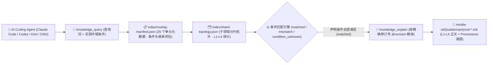

<p align="center">
  
</p>

<h1 align="center">MindIE Agent Knowledge — MindIE-SD 扩散模型加速知识库 (<code>knowledge-mindie-sd</code>)</h1>

<p align="center">
  <strong>面向昇腾 NPU 多模态扩散生成模型（DiT / MMDiT / 3D-VAE）的 L1–L4 分级工程知识库：覆盖 RainFusion/AdaBSA/EagleQBSA 块稀疏注意力、USP (Ulysses/Ring/CFG) 混合序列并行、DiTCache/AttentionCache 跨步复用、W8A8/MXFP8/W4A4/MXFP4 分级量化与 3D 因果 VAE 状态携带切分</strong>
</p>

<p align="center">
  <a href="https://github.com/mindie-agent/mindie-agent"></a>
  <a href="./publication-contract.json"></a>
  <a href="./publication-contract.json"></a>
  <a href="./index/routing-manifest.json"></a>
  <a href="./index/shard-topology.json"></a>
</p>

<p align="center">
  <strong>中文</strong> · <a href="./README.en.md">English</a> · <a href="#-一句话接入与检索">⚡ 一句话接入</a> · <a href="#️-领域全景与-l1l4-分级架构">🏗️ 分级架构</a> · <a href="#-子领域分布与代表性知识单元">📊 语料全景</a> · <a href="#-仓库结构与隐私质量门禁">🛡️ 结构与门禁</a>
</p>

---

## ⚡ 一句话接入与检索

你不需要手动克隆或配置索引。在 **Claude Code**、**OpenAI Codex CLI**、**Kimi Code** 或 **DeepSeek Harness (DSH)** 中，直接复制并发送下面这句话给你的 AI Agent：

```text
帮我安装一下这个 https://github.com/mindie-agent/mindie-agent
```

宿主插件就绪后会自动连接 [`mindie-knowledge`](https://github.com/mindie-agent/knowledge) 本地运行时，按需同步本仓库（`--domain mindie-sd`）并在本地构建毫秒级确定性检索索引。只读检索与全文读取**完全在本地执行，不消耗大模型 Token，也不要求开启社区共享**。

<details>
<summary>🤖 <b>AI Agent 自动安装与知识检索协议（点击展开 / Agent 读取本页时可直接解析执行）</b></summary>

> **给 AI Agent 的执行指南**：
>
> #### 1. 一键安装宿主插件
> 若当前宿主尚未安装 MindIE Agent，请先读取主仓库 [`https://github.com/mindie-agent/mindie-agent`](https://github.com/mindie-agent/mindie-agent) 的安装协议完成对应宿主插件注册。
>
> #### 2. 命令行同步与检查 `mindie-sd` 领域语料
> ```bash
> # 同步 mindie-sd 领域最新经校验的公开知识源（零模型调用）
> mindie-knowledge sync --domain mindie-sd
>
> # 查看本地知识索引状态与脱敏规则版本
> mindie-knowledge status --domain mindie-sd
> python3 -m mindie_knowledge.redact --profile
> ```
>
> #### 3. MCP 工具检索、精确全文读取与版本化反馈
> 在解决 `mindie-sd` 相关工程任务时，遵循 **先按实测条件检索 (`knowledge_query`) → 再按精确修订号读全文 (`knowledge_explain`) → 验证后可选反馈 (`knowledge_feedback`)** 的标准工作流：
>
> ```python
> # Step 1: 仅传入当前任务真实观测到的环境/版本条件（严禁猜测或抄写未观测条件）
> knowledge_query(
>     query="rainfusion rf_v2 rf_v3 3d window rearrange blockwise mask",
>     conditions={
>         "framework": "mindie-sd"
>     },
> )
>
> # Step 2: 使用返回的精确修订引用 (@revision) 读取完整正文、前置条件与继承闭包
> knowledge_explain(
>     ref="mindie://mindie-sd/units/unit-mindie-sd-rainfusion-rf-v2-rf-v3-layout-and-block-mask-sop@1",
> )
>
> # Step 3: 实机验证有效后，针对实际观测过的修订号记录本地有用性反馈（可选）
> knowledge_feedback(
>     ref="mindie://mindie-sd/units/unit-mindie-sd-rainfusion-rf-v2-rf-v3-layout-and-block-mask-sop@1",
>     rating="up",
>     reason="Verified RainFusion V2/V3 3D window rearrange and first-frame protection on Ascend NPU.",
> )
> ```

</details>

在 vLLM-Omni 的 Consult 阶段，按已确认的库源码修订和实际调用路径查找 MindIE-SD 算子知识。下面是条件填写示例。只有部署证据吻合时才使用这些值。包已安装或配置为 FLASH_ATTN 时，可用 include_unknown=True 探索仍缺哪些条件。整套调优和并行规程继续按其各自条件筛选。

```python
observed = {
    "framework": "vllm-omni",
    "repository": "Ascend/MindIE-SD",
    "revision": "9fe772dfb90696e21b5e5d4e92ca07dffab84cf4",
    "attention_implementation": "mindiesd.attention_forward",
}
knowledge_query(domain="mindie-sd", query="dense attention_forward dispatch", conditions=observed)
knowledge_explain(
    ref="mindie://mindie-sd/units/unit-mindie-sd-dense-attention-dispatch-sop@1",
    conditions=observed,
)
```

---

## 🏗️ 领域全景与 L1–L4 分级架构

本仓库承载 MindIE Agent 的 **`mindie-sd` 独立领域分级知识源**（共 **25 个分级知识单元**：`L1: 3`、`L2: 15`、`L3: 7`、`L4: 0`）。专门面向昇腾 800I A2 (910B)、800I A3 (910C) 与 Ascend 950 (A5) 上的多模态视频与图像生成扩散模型加速框架 `MindIE-SD`，系统沉淀了：

- **架构公理（`mindie-sd/concepts/architecture`）**：DiT 稀疏注意力、跨步缓存与量化的正交加速公理；USP（Ulysses All-to-All、Ring P2P LSE 在线合并、CFG 并行与 `AllGather-KV × Ulysses` 复合形态）序列并行不变量；以及自定义 C++/AscendC/Triton/Catlass 算子编译分发与 A5 硬件守卫公理。
- **DiT 稀疏与跨步缓存（`mindie-sd/dit-compute/sparse-and-cache`）**：RainFusion V2/V3 3D 时空窗重排与首帧/文本保护、AdaBSA 自适应 CDF 块稀疏、EagleQBSA（Q/K INT8 + V FP8）与 Hadamard 旋转 FP8 块稀疏，以及 `CacheAgent`（`DiTBlockCache` / `AttentionCache`）跨步复用标定工作流。
- **USP 与 CFG 序列并行（`mindie-sd/parallel/usp-and-cfg`）**：Ulysses/Ring 混合注意力与 FP8/MXFP8 通信量化、CFG 正交进程组划分与专用通信流掩盖（Comm-Stream Masking）、非整除序列 `S_PAD` 填充对齐绕过 `HcclAlltoAllV` 崩溃，以及“先汇聚后稀疏”叠加契约。
- **量化契约与精度恢复（`mindie-sd/quantization/contracts`）**：`W8A8_TIMESTEP` 与 `TimestepManager` 动态同步、`W8A8_MXFP8` / `W4A4_MXFP4_DUALSCALE` / `W4A4_MXFP4_FOUROVERSIX_DYNAMIC`（A5 4/6 自适应量化）及 `FP8RotateQuantFA` 分级选档与敏感层回退，以及 `quantize()` 原地替换防显存双倍峰值规程。
- **3D 因果 VAE 切分与异步卸载（`mindie-sd/vae-and-offload/sliced-decode`）**：WanVAE / HunyuanVAE / `taehv` 跨轴耦合审计、潜帧边界状态携带切分（`MemBlock` 输入末帧激活传递）与四道等价验证闸、双流异步参数卸载（`enable_offload` + `untyped_storage().resize_(0)`）以及单机多实例 ZMQ IPC 共享内存（`ShareMemoryManager`）。
- **自定义算子、融合分析与 S0–S6 模型调优配方（`mindie-sd/operators/*`, `mindie-sd/workflows/*`, `mindie-sd/models/recipes`）**：RainFusion/EagleQBSA/Catlass/Triton 算子规程、`fusion-scope-analyze` 流水线利用率天花板分析、S0–S6 自动调优与 `kb_lint` 门禁，以及 Wan2.1/Wan2.2、FLUX.1-dev、Qwen-Image、HunyuanVideo、HunyuanImage-3.0（`DyEPLB`）与 MiniMax-H3 端到端优化配方。

### 1. `mindie-graded-unit/1` 四级知识单元体系（L1–L4）

本知识库拒绝碎片化的聊天摘要或脱离前提的“万能经验”，所有知识单元均按工程抽象粒度与可操作性划分为 **L1–L4 四个层级**（当前分布：**L1: 3 · L2: 15 · L3: 7 · L4: 0**）：

| 层级 | 标准类别 (`category`) | 工程定位 | 核心内容与准入要求 |
| :---: | --- | --- | --- |
| **L1** | `canonical-fact` (`axiom` / `measurement`) | **事实与约束标准** | 硬件微架构规格、MindIE-SD 稀疏/缓存/量化/USP 核心数学与形状不变量、自定义算子 ABI 分发规则。常作为上层单元的继承前提（`inherits_from`）。 |
| **L2** | `sop` | **标准排障与开发规程** | 确定性的分步配置、算子调用、序列并行选型、量化替换与 3D VAE 切分标准作业程序（SOP），明确列出观测指标、判别分支与反模式警报。 |
| **L3** | `workflow` | **多阶段工程工作流** | 端到端多阶段闭环工作流（如 S0–S6 模型自动调优、并行×稀疏叠加标定、分级量化精度回退、VAE 四道等价验证闸与 Wan2.1/2.2 联合调优）。 |
| **L4** | `optimization-pattern` (`mutator`) | **深度调优模式** | 经过实测验证的 Kernel / 计算图 / 通信并行代码变换模式（Mutator），附带严格的适用条件（`conditions`）、消融前后性能包络与源码溯源（`provenance`）。 |

### 2. 条件化路由与精确全文检索架构



> [!IMPORTANT]
> **严格条件匹配原则（No Silent Guesswork）**：查询时，`mindie-knowledge` 会将任务真实观测到的 `conditions` 与知识单元声明的适用前提逐项比对。只有所有声明条件均满足时才判定为 `matched`；缺失或未知的条件判定为 `condition_unknown` 并默认过滤，避免将特定硬件型号或特定源码提交下的结论误用于不兼容环境。

---

## 📊 子领域分布与代表性知识单元

[`index/routing-manifest.json`](./index/routing-manifest.json) 与 [`index/shard-topology.json`](./index/shard-topology.json) 是由全量 Markdown 单元派生的权威实时清单。当前仓库共包含 **25 个分级知识单元**（**L1: 3 · L2: 15 · L3: 7 · L4: 0**）：

### 1. 子领域分片（Leaf Shard）分布统计

| 子领域路径 (`domain_path`) | 单元数量 | 层级分布 (`L1–L4`) | 核心覆盖范围 |
| --- | :---: | :---: | --- |
| `mindie-sd/concepts/architecture` | **3** | `L1: 3` | DiT 块稀疏/跨步缓存/时间步量化加速公理、USP (Ulysses/Ring/CFG/AllGather-KV) 序列并行公理、C++/AscendC/Triton/Catlass 自定义算子分发公理 |
| `mindie-sd/dit-compute/sparse-and-cache` | **4** | `L2: 3, L3: 1` | DiT 计算瓶颈选档 SOP、RainFusion V2/V3 3D 时空窗重排与首帧保护 SOP、AdaBSA 与 EagleQBSA/FP8 旋转量化块稀疏 SOP、`CacheAgent` (`DiTBlockCache`/`AttentionCache`) 标定工作流 |
| `mindie-sd/parallel/usp-and-cfg` | **3** | `L2: 2, L3: 1` | USP Ulysses All-to-All 与 Ring P2P 注意力及 FP8/MXFP8 通信量化 SOP、CFG 正交进程组与 `AllGather-KV × Ulysses` 复合选型及通信流掩盖 SOP、`S_PAD` 对齐绕过 `HcclAlltoAllV` 与并行×稀疏叠加工作流 |
| `mindie-sd/quantization/contracts` | **4** | `L2: 3, L3: 1` | 量化设备字节契约与对齐 SOP、`W8A8_TIMESTEP` 与 `TimestepManager` 动态同步 SOP、`quantize()` 描述符解析与原地替换 SOP、`W8A8/MXFP8/W4A4/MXFP4` 分级量化与精度回退工作流 |
| `mindie-sd/vae-and-offload/sliced-decode` | **4** | `L2: 3, L3: 1` | VAE/TAE 状态携带切分与卸载总览 SOP、3D 因果 VAE (WanVAE/HunyuanVAE/TAEHV) 跨轴耦合审计与潜帧边界切分 SOP、双流异步 `enable_offload` 与 `ShareMemoryManager` IPC 共享内存 SOP、VAE 四道等价验证闸与防死锁工作流 |
| `mindie-sd/models/recipes` | **3** | `L2: 2, L3: 1` | Wan2.1/Wan2.2 视频 DiT（稀疏×USP×量化×3D VAE）联合调优工作流、FLUX.1 / Qwen-Image / SD3 MMDiT 双流图像扩散调优 SOP、HunyuanVideo / HunyuanImage-3.0 (`DyEPLB`) / MiniMax-H3 调优 SOP |
| `mindie-sd/operators/custom-ops` | **2** | `L2: 2` | MindIE-SD 自定义 C++/AscendC/TIK/Triton/Catlass 算子（RainFusion、EagleQBSA、LaPreprocess、`mm_swiglu_mxquant`）开发与调度 SOP |
| `mindie-sd/operators/fusion-analysis` | **1** | `L3: 1` | `fusion-scope-analyze` 结构边界划分规则（Rules 1–6）、`PipeUtilization` 收益上限估算与等工作量后验审计工作流 |
| `mindie-sd/workflows/s0-s6-auto-opt` | **1** | `L3: 1` | MindIE-SD S0–S6 端到端扩散模型自动调优状态机、组合消融验证与 `kb_lint` 知识入库门禁工作流 |

### 2. 全量分级知识单元索引（All 25 Graded Units）

| 知识单元 ID（点击查看原文） | 子领域路径 | 层级 / 类别 | 工程主题与摘要 | 固定修订引用 (`ref`) |
| --- | --- | :---: | --- | --- |
| [`unit-mindie-sd-dit-acceleration-sparse-cache-and-quantization-axioms`](./mindie-sd/concepts/architecture/unit-mindie-sd-dit-acceleration-sparse-cache-and-quantization-axioms.md) | `mindie-sd/concepts/architecture` | **L1** / `axiom` | MindIE-SD DiT 块稀疏注意力（RainFusion/Ada-BSA/EagleQBSA）、跨步缓存（DiTCache）与时间步量化加速公理 | `mindie://mindie-sd/units/unit-mindie-sd-dit-acceleration-sparse-cache-and-quantization-axioms@1` |
| [`unit-mindie-sd-usp-ulysses-ring-and-cfg-sequence-parallel-axioms`](./mindie-sd/concepts/architecture/unit-mindie-sd-usp-ulysses-ring-and-cfg-sequence-parallel-axioms.md) | `mindie-sd/concepts/architecture` | **L1** / `axiom` | MindIE-SD 序列并行（Ulysses AllToAll、Ring P2P 注意力、CFG 并行与混合 USP）拓扑与形状不变量公理 | `mindie://mindie-sd/units/unit-mindie-sd-usp-ulysses-ring-and-cfg-sequence-parallel-axioms@1` |
| [`unit-mindie-sd-custom-csrc-ascendc-triton-catlass-operator-dispatch-axioms`](./mindie-sd/concepts/architecture/unit-mindie-sd-custom-csrc-ascendc-triton-catlass-operator-dispatch-axioms.md) | `mindie-sd/concepts/architecture` | **L1** / `axiom` | MindIE-SD 自定义 C++/AscendC/Triton/Catlass 算子注册、ABI 分发与 A5 硬件平台守卫公理 | `mindie://mindie-sd/units/unit-mindie-sd-custom-csrc-ascendc-triton-catlass-operator-dispatch-axioms@1` |
| [`unit-mindie-sd-dit-compute-sparse-cache-and-quant-selection-sop`](./mindie-sd/dit-compute/sparse-and-cache/unit-mindie-sd-dit-compute-sparse-cache-and-quant-selection-sop.md) | `mindie-sd/dit-compute/sparse-and-cache` | **L2** / `sop` | MindIE-SD DiT 计算瓶颈优化、稀疏/量化/缓存分档选型与组合搜索规程 | `mindie://mindie-sd/units/unit-mindie-sd-dit-compute-sparse-cache-and-quant-selection-sop@1` |
| [`unit-mindie-sd-rainfusion-rf-v2-rf-v3-layout-and-block-mask-sop`](./mindie-sd/dit-compute/sparse-and-cache/unit-mindie-sd-rainfusion-rf-v2-rf-v3-layout-and-block-mask-sop.md) | `mindie-sd/dit-compute/sparse-and-cache` | **L2** / `sop` | MindIE-SD RainFusion V2/V3 3D 时空窗重排、分块池化掩码与首帧保护规程 | `mindie://mindie-sd/units/unit-mindie-sd-rainfusion-rf-v2-rf-v3-layout-and-block-mask-sop@1` |
| [`unit-mindie-sd-ada-bsa-and-eagleqbsa-dynamic-sparse-attention-sop`](./mindie-sd/dit-compute/sparse-and-cache/unit-mindie-sd-ada-bsa-and-eagleqbsa-dynamic-sparse-attention-sop.md) | `mindie-sd/dit-compute/sparse-and-cache` | **L2** / `sop` | MindIE-SD AdaBSA 自适应 CDF 块稀疏与 EagleQBSA/FP8 旋转量化块稀疏规程 | `mindie://mindie-sd/units/unit-mindie-sd-ada-bsa-and-eagleqbsa-dynamic-sparse-attention-sop@1` |
| [`unit-mindie-sd-cache-agent-ditcache-attentioncache-calibration-workflow`](./mindie-sd/dit-compute/sparse-and-cache/unit-mindie-sd-cache-agent-ditcache-attentioncache-calibration-workflow.md) | `mindie-sd/dit-compute/sparse-and-cache` | **L3** / `workflow` | MindIE-SD CacheAgent DiTBlockCache 与 AttentionCache 跨步复用标定工作流 | `mindie://mindie-sd/units/unit-mindie-sd-cache-agent-ditcache-attentioncache-calibration-workflow@1` |
| [`unit-mindie-sd-usp-ulysses-alltoall-and-ring-p2p-attention-sop`](./mindie-sd/parallel/usp-and-cfg/unit-mindie-sd-usp-ulysses-alltoall-and-ring-p2p-attention-sop.md) | `mindie-sd/parallel/usp-and-cfg` | **L2** / `sop` | MindIE-SD USP Ulysses All-to-All 与 Ring P2P 混合序列并行注意力规程 | `mindie://mindie-sd/units/unit-mindie-sd-usp-ulysses-alltoall-and-ring-p2p-attention-sop@1` |
| [`unit-mindie-sd-cfg-parallel-group-init-and-allgather-kv-hybrid-sop`](./mindie-sd/parallel/usp-and-cfg/unit-mindie-sd-cfg-parallel-group-init-and-allgather-kv-hybrid-sop.md) | `mindie-sd/parallel/usp-and-cfg` | **L2** / `sop` | MindIE-SD CFG 并行通信组正交划分、AllGather-KV×Ulysses 复合选型与通信流掩盖规程 | `mindie://mindie-sd/units/unit-mindie-sd-cfg-parallel-group-init-and-allgather-kv-hybrid-sop@1` |
| [`unit-mindie-sd-sequence-padding-alignment-and-multi-card-scaling-workflow`](./mindie-sd/parallel/usp-and-cfg/unit-mindie-sd-sequence-padding-alignment-and-multi-card-scaling-workflow.md) | `mindie-sd/parallel/usp-and-cfg` | **L3** / `workflow` | MindIE-SD 序列并行填充对齐、AlltoAllV 缺陷绕过与并行×稀疏叠加工作流 | `mindie://mindie-sd/units/unit-mindie-sd-sequence-padding-alignment-and-multi-card-scaling-workflow@1` |
| [`unit-mindie-sd-quantization-device-byte-contract-and-alignment-sop`](./mindie-sd/quantization/contracts/unit-mindie-sd-quantization-device-byte-contract-and-alignment-sop.md) | `mindie-sd/quantization/contracts` | **L2** / `sop` | MindIE-SD 量化权重设备常驻字节契约、对齐校验与逐层精度回退规程 | `mindie://mindie-sd/units/unit-mindie-sd-quantization-device-byte-contract-and-alignment-sop@1` |
| [`unit-mindie-sd-timestep-aware-dynamic-quantization-calibration-sop`](./mindie-sd/quantization/contracts/unit-mindie-sd-timestep-aware-dynamic-quantization-calibration-sop.md) | `mindie-sd/quantization/contracts` | **L2** / `sop` | MindIE-SD W8A8_TIMESTEP 时间步感知量化与 TimestepManager 动态切换规程 | `mindie://mindie-sd/units/unit-mindie-sd-timestep-aware-dynamic-quantization-calibration-sop@1` |
| [`unit-mindie-sd-quantize-model-descriptor-and-quantlinear-replacement-sop`](./mindie-sd/quantization/contracts/unit-mindie-sd-quantize-model-descriptor-and-quantlinear-replacement-sop.md) | `mindie-sd/quantization/contracts` | **L2** / `sop` | MindIE-SD quantize() 模型描述符解析、Safetensors 权重挂载与 QuantLinear 原地替换规程 | `mindie://mindie-sd/units/unit-mindie-sd-quantize-model-descriptor-and-quantlinear-replacement-sop@1` |
| [`unit-mindie-sd-w8a8-mxfp8-w4a4-mxfp4-calibration-and-accuracy-recovery-workflow`](./mindie-sd/quantization/contracts/unit-mindie-sd-w8a8-mxfp8-w4a4-mxfp4-calibration-and-accuracy-recovery-workflow.md) | `mindie-sd/quantization/contracts` | **L3** / `workflow` | MindIE-SD W8A8/MXFP8/W4A4/MXFP4 线性层与注意力分级量化及精度回退工作流 | `mindie://mindie-sd/units/unit-mindie-sd-w8a8-mxfp8-w4a4-mxfp4-calibration-and-accuracy-recovery-workflow@1` |
| [`unit-mindie-sd-vae-tae-sliced-state-decode-and-offload-sop`](./mindie-sd/vae-and-offload/sliced-decode/unit-mindie-sd-vae-tae-sliced-state-decode-and-offload-sop.md) | `mindie-sd/vae-and-offload/sliced-decode` | **L2** / `sop` | MindIE-SD 3D 因果 VAE/TAEHV 潜帧边界状态携带切分解码与层间卸载规程 | `mindie://mindie-sd/units/unit-mindie-sd-vae-tae-sliced-state-decode-and-offload-sop@1` |
| [`unit-mindie-sd-3d-causal-vae-wanvae-hunyuan-taehv-temporal-tiling-sop`](./mindie-sd/vae-and-offload/sliced-decode/unit-mindie-sd-3d-causal-vae-wanvae-hunyuan-taehv-temporal-tiling-sop.md) | `mindie-sd/vae-and-offload/sliced-decode` | **L2** / `sop` | MindIE-SD 3D 因果 VAE（WanVAE / HunyuanVAE / TAEHV）跨轴耦合审计与潜帧边界切分规程 | `mindie://mindie-sd/units/unit-mindie-sd-3d-causal-vae-wanvae-hunyuan-taehv-temporal-tiling-sop@1` |
| [`unit-mindie-sd-layerwise-cpu-npu-hbm-async-offload-and-share-memory-sop`](./mindie-sd/vae-and-offload/sliced-decode/unit-mindie-sd-layerwise-cpu-npu-hbm-async-offload-and-share-memory-sop.md) | `mindie-sd/vae-and-offload/sliced-decode` | **L2** / `sop` | MindIE-SD DiT 双流异步参数 Offload（storage.resize_）与单机多实例 IPC 共享内存规程 | `mindie://mindie-sd/units/unit-mindie-sd-layerwise-cpu-npu-hbm-async-offload-and-share-memory-sop@1` |
| [`unit-mindie-sd-vae-state-carry-feature-cache-and-equivalence-gate-workflow`](./mindie-sd/vae-and-offload/sliced-decode/unit-mindie-sd-vae-state-carry-feature-cache-and-equivalence-gate-workflow.md) | `mindie-sd/vae-and-offload/sliced-decode` | **L3** / `workflow` | MindIE-SD VAE/TAE 状态携带切分四道等价验证闸与集体通信防死锁工作流 | `mindie://mindie-sd/units/unit-mindie-sd-vae-state-carry-feature-cache-and-equivalence-gate-workflow@1` |
| [`unit-mindie-sd-custom-sparse-attention-catlass-ffn-and-triton-ops-sop`](./mindie-sd/operators/custom-ops/unit-mindie-sd-custom-sparse-attention-catlass-ffn-and-triton-ops-sop.md) | `mindie-sd/operators/custom-ops` | **L2** / `sop` | MindIE-SD 自定义 C++/AscendC/TIK/Triton/Catlass 算子（RainFusion、EagleQBSA、LaPreprocess、mm_swiglu_mxquant）规程 | `mindie://mindie-sd/units/unit-mindie-sd-custom-sparse-attention-catlass-ffn-and-triton-ops-sop@1` |
| [`unit-mindie-sd-dense-attention-dispatch-sop`](./mindie-sd/operators/custom-ops/unit-mindie-sd-dense-attention-dispatch-sop.md) | `mindie-sd/operators/custom-ops` | **L2** / `sop` | vLLM-Omni 等调用方的 MindIE-SD 稠密注意力分发规程 | `mindie://mindie-sd/units/unit-mindie-sd-dense-attention-dispatch-sop@1` |
| [`unit-mindie-sd-fusion-scope-analyze-and-pipe-benefit-workflow`](./mindie-sd/operators/fusion-analysis/unit-mindie-sd-fusion-scope-analyze-and-pipe-benefit-workflow.md) | `mindie-sd/operators/fusion-analysis` | **L3** / `workflow` | MindIE-SD fusion-scope-analyze 结构边界划分规则、PipeUtilization 收益上限估算与等工作量后验审计工作流 | `mindie://mindie-sd/units/unit-mindie-sd-fusion-scope-analyze-and-pipe-benefit-workflow@1` |
| [`unit-mindie-sd-model-auto-optimization-s0-s6-and-kb-lint-workflow`](./mindie-sd/workflows/s0-s6-auto-opt/unit-mindie-sd-model-auto-optimization-s0-s6-and-kb-lint-workflow.md) | `mindie-sd/workflows/s0-s6-auto-opt` | **L3** / `workflow` | MindIE-SD S0–S6 端到端扩散模型自动调优状态机、组合消融验证与 kb-lint 知识门禁工作流 | `mindie://mindie-sd/units/unit-mindie-sd-model-auto-optimization-s0-s6-and-kb-lint-workflow@1` |
| [`unit-mindie-sd-wan21-wan22-video-dit-sparse-usp-and-quant-recipe-workflow`](./mindie-sd/models/recipes/unit-mindie-sd-wan21-wan22-video-dit-sparse-usp-and-quant-recipe-workflow.md) | `mindie-sd/models/recipes` | **L3** / `workflow` | MindIE-SD Wan2.1/Wan2.2 视频生成模型（稀疏注意力 × USP × 量化 × 3D VAE）联合调优工作流 | `mindie://mindie-sd/units/unit-mindie-sd-wan21-wan22-video-dit-sparse-usp-and-quant-recipe-workflow@1` |
| [`unit-mindie-sd-flux1-qwen-image-and-sd3-mmdit-optimization-recipe-sop`](./mindie-sd/models/recipes/unit-mindie-sd-flux1-qwen-image-and-sd3-mmdit-optimization-recipe-sop.md) | `mindie-sd/models/recipes` | **L2** / `sop` | MindIE-SD Flux.1 / Qwen-Image / SD3 MMDiT 双流图像扩散模型联合调优规程 | `mindie://mindie-sd/units/unit-mindie-sd-flux1-qwen-image-and-sd3-mmdit-optimization-recipe-sop@1` |
| [`unit-mindie-sd-hunyuanvideo-cogvideox-and-minimax-h3-optimization-recipe-sop`](./mindie-sd/models/recipes/unit-mindie-sd-hunyuanvideo-cogvideox-and-minimax-h3-optimization-recipe-sop.md) | `mindie-sd/models/recipes` | **L2** / `sop` | MindIE-SD HunyuanVideo / HunyuanImage-3.0 / MiniMax-H3 MoE 与多模态扩散调优规程 | `mindie://mindie-sd/units/unit-mindie-sd-hunyuanvideo-cogvideox-and-minimax-h3-optimization-recipe-sop@1` |

---

## 🛡️ 仓库结构与隐私质量门禁

### 1. 仓库目录结构

```text
knowledge-mindie-sd/
├── .github/workflows/check.yml         # 零信任数据校验与双层隐私脱敏 CI 门禁
├── publication-contract.json           # 发布契约 (mindie-publication-contract/2) 与固定 Validator 修订号
├── AGENTS.md                           # 维护者与 AI Agent 仓库操作边界规范
├── README.md                           # 中文主文档
├── README.en.md                        # 英文主文档 (English Documentation)
├── LICENSE                             # 双许可声明 (CC BY 4.0 语料与文档 + MIT 维护脚本)
├── scripts/                            # 索引构建、语料 Lint 与分片规划薄封装脚本
├── index/
│   ├── routing-manifest.json           # [派生索引] 全量单元 ID、路径、层级、条件、继承闭包与 Token 估算
│   └── shard-topology.json             # [派生索引] 子领域分片计数与层级拓扑
└── mindie-sd/.../unit-*.md             # [核心语料] L1–L4 分级知识单元 Markdown 正文与 YAML Frontmatter
```

### 2. 双层隐私脱敏与确定性 CI 发布门禁（`.github/workflows/check.yml`）

本仓库作为公开工程知识源，在本地构建与 GitHub Actions CI（`check.yml`）中强制执行**零信任数据校验与双层隐私脱敏门禁**：

1. **不可变契约与纯数据校验（`publication_check.validate`）**：
   - CI 从可信基准读取 [`publication-contract.json`](./publication-contract.json)，安装精确固定提交的 `mindie-knowledge` 校验器；
   - 所有候选文件仅作为 Git 数据对象（`git cat-file --batch`）流式读取，**绝不在 CI 中执行任何候选代码**；
   - 严格校验每个 `unit-*.md` 的 Schema（`mindie-graded-unit/1`）、路径与稳定 ID 一致性、修订号与 SHA-256 内容摘要、父子继承有向无环图（DAG），以及 `index/routing-manifest.json` 和 `index/shard-topology.json` 与实际单元的 100% 一致性。
2. **双层闭锁式隐私扫描（Gitleaks + `mindie_knowledge.redact` `r3`）**：
   - 全仓所有文本文件、知识单元 Frontmatter/正文、公开反馈及 PR 标题/描述均经过确定性隐私扫描；
   - **严禁包含**任何本地宿主绝对路径（如个人主目录、挂载卷路径）、私有内网 IPv4/IPv6 地址段、SSH 登录凭据、API 密钥或内部机器名，一旦命中立即阻断合入。

---

## 🔗 关联仓库与生态导航

- **主仓库与一键安装入口**：[`mindie-agent/mindie-agent`](https://github.com/mindie-agent/mindie-agent)
- **知识检索与隐私脱敏运行时**：[`mindie-agent/knowledge`](https://github.com/mindie-agent/knowledge)（Python 包 `mindie-knowledge`）
- **八大公开领域知识库矩阵**：
  - [`knowledge-vllm-ascend`](https://github.com/mindie-agent/knowledge-vllm-ascend) — `vLLM-Ascend` 与 `vLLM-Omni` 适配、图编译、MoE、PD 分离与多阶段全模态流水线（91 Units）
  - [`knowledge-mindie-sd`](https://github.com/mindie-agent/knowledge-mindie-sd) — `MindIE-SD` 多模态扩散模型（DiT/MMDiT/3D-VAE）块稀疏注意力、USP 序列并行、跨步缓存与量化加速（25 Units）
  - [`knowledge-operators`](https://github.com/mindie-agent/knowledge-operators) — AscendC / BiShengIR / Triton / TileLang 算子开发与优化（103 Units）
  - [`knowledge-infer-core`](https://github.com/mindie-agent/knowledge-infer-core) — 核心推理引擎调度、KV Cache 与服务化架构（105 Units）
  - [`knowledge-infer-distributed`](https://github.com/mindie-agent/knowledge-infer-distributed) — HCCL 集合通信、RoCE/HCCS 拓扑、Ulysses/Ring/CFG 混合并行与 SHMEM（39 Units）
  - [`knowledge-infer-observability`](https://github.com/mindie-agent/knowledge-infer-observability) — CANN 故障诊断、`msprof` 性能剖析与 A/B/A 性能/精度门禁（39 Units）
  - [`knowledge-infer-ops-compat`](https://github.com/mindie-agent/knowledge-infer-ops-compat) — GE/TorchAir/Inductor 图编译、自定义算子注册与两阶段框架集成（34 Units）
  - [`knowledge-agent-engineering`](https://github.com/mindie-agent/knowledge-agent-engineering) — 智能体编排、脱敏审计与基准评测（32 Units）

---

## 📄 开源许可（License）

本仓库遵循 [`LICENSE`](./LICENSE) 双许可声明（与 `mindie-publication-contract/2` 仓库结构对齐）：

- **知识语料、派生索引、公开反馈与文档证据**（`<domain_path>/unit-*.md`、`index/`、`feedback/`、`README.md`、`README.en.md`、`AGENTS.md`、`docs/`）采用 **[Creative Commons Attribution 4.0 International (CC BY 4.0)](./LICENSE)** 许可协议。
- **仓库维护脚本与工作流配置**（`scripts/`、`.github/workflows/`、`publication-contract.json`）采用 **[MIT License](./LICENSE)** 许可协议。
